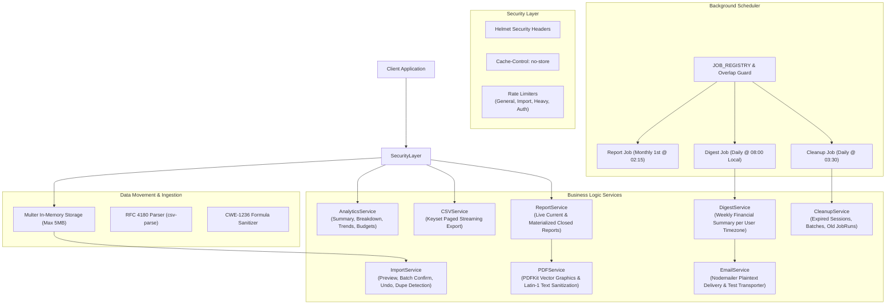

# FinTrack: Module B4 (Insights, Data Movement and Hardening) Architecture & Codebase Documentation

This document provides a comprehensive, end-to-end breakdown of all work completed for **Module B4 (Insights, Data Movement, and Hardening)** of the **FinTrack** personal finance platform, along with the consolidated system verification across Modules B1, B2, B3, and B4.

---

## Table of Contents
1. [Module Overview & Architecture](#1-module-overview--architecture)
2. [File Inventory & Responsibilities](#2-file-inventory--responsibilities)
3. [Deep Dive: Implementation Details & Code Logic](#3-deep-dive-implementation-details--code-logic)
   - Configuration & Limits
   - Pure Mathematical & Parsing Utilities
   - Analytics Engine
   - CSV Export & Streaming
   - Stateless CSV Import & Batch Engine
   - Monthly Financial Reports & PDF Generation
   - Scheduled Background Jobs & Email Delivery
   - Security Hardening, Rate Limiting & Middlewares
4. [API Endpoints Reference](#4-api-endpoints-reference)
5. [Verification & Test Results](#5-verification--test-results)
6. [Commands to Run & Verify](#6-commands-to-run--verify)

---

## 1. Module Overview & Architecture

Module B4 delivers the analytical, data mobility, reporting, and production hardening capabilities of FinTrack. It layers on top of B1 (Core & Identity), B2 (Money Core: Transactions & Budgets), and B3 (Automation & Savings Goals).



### Core Design Principles in B4
1. **Zero Magic Literals**:
   - All rate limiters, cron patterns, thresholds, and limits reside in `src/config/limits.ts` and `src/config/env.ts`.
2. **Formula Injection (CWE-1236) Protection**:
   - All exported CSV cells starting with formula triggers (`=`, `+`, `-`, `@`, `\t`, `\r`) are escaped with a leading single quote `'`. On import, single quotes are un-escaped safely.
3. **Exact Decimal Arithmetic**:
   - Every financial computation (savings rates, percentage variances, category totals, net cashflow) strictly utilizes `Prisma.Decimal`. JavaScript floating-point arithmetic (`Number`, `parseFloat`) is never used for money.
4. **Keyset Paging for Large Streaming**:
   - CSV export processes data in batches of 1,000 using keyset pagination `(date DESC, id DESC)` over raw database streams to ensure $O(1)$ memory consumption even with 50,000 transactions.
5. **Safe Native PDF Rendering**:
   - Built with `pdfkit`. To eliminate font rendering crashes caused by external UTF-8 symbols (such as emojis or accented characters unsupported by built-in Helvetica), a Latin-1 character sanitizer maps or strips incompatible glyphs.
6. **Stateless CSV Ingestion**:
   - File uploads remain entirely in-memory (`multer.memoryStorage()`). No files touch disk.
   - Preview parses the first 10 rows and returns auto-suggested column mappings.
   - Confirm accepts the user mapping and options, processes in chunks of 500 in an atomic transaction, skips duplicate transactions within a 3-day window, and records an `ImportBatch` allowing 1-click undo within 7 days.
7. **Idempotent Reporting & Dynamic Cache**:
   - Current calendar month is computed on-the-fly (`live: true`, `id: null`).
   - Closed historical months are cached and materialized as an immutable `MonthlyReport` row upon first request. Users can trigger an on-demand recalculation via `POST /reports/regenerate`.

---

## 2. File Inventory & Responsibilities

| File Path | Role | Description |
| :--- | :--- | :--- |
| `src/config/env.ts` | Configuration | Adds cron schedules (`REPORT_CRON`, `CLEANUP_CRON`, `DIGEST_CRON`), rate limit window settings, and SMTP configuration with cross-validation refinements. |
| `src/config/limits.ts` | Limits Policy | Centralizes all thresholds: CSV limits, batch sizes, trend intervals, report pagination, digest schedules, and test coverage thresholds. |
| `src/utils/ApiError.ts` | Error Handling | Error constants and factory methods for import, export, report, and range validation errors. |
| `src/utils/dates.ts` | Date Utilities | Zoned timestamps, range boundaries (`dateBoundsError`), intervals (`eachDay`, `eachWeekStart`, `eachMonth`), and timezone calculations. |
| `src/utils/money.ts` | Money Math | `percentChange` and `savingsRate` calculations using `Prisma.Decimal`. |
| `src/utils/range.ts` | Analytics Range | Pure helper resolving presets (`this_month`, `last_30_days`, `last_year`, etc.) and computing comparative previous periods. |
| `src/utils/csv.ts` | CSV Protection | Formula injection escaping (`sanitizeCell`, `unsanitizeCell`), RFC 4180 line escaping, and export size guards. |
| `src/utils/csvImport.ts` | CSV Ingestion Helper | Delimiter auto-detection (`,`, `;`, `\t`), header normalization, column mapping heuristics, date/amount parsing. |
| `src/utils/download.ts` | HTTP Headers | Encapsulates `Content-Disposition`, `Content-Type`, and `Cache-Control` download headers. |
| `src/middleware/upload.ts` | File Upload | Multer in-memory configuration with a 5 MB ceiling and CSV MIME type/extension filtering. |
| `src/middleware/rateLimit.ts` | Security | Express rate-limiters: `importLimiter` (10 req/15 min) and `heavyLimiter` (30 req/min for reports and exports). |
| `src/middleware/errorHandler.ts` | Error Formatting | Maps Multer `LIMIT_FILE_SIZE` to 413 `PAYLOAD_TOO_LARGE` and CSV parsing failures to 400 `IMPORT_FILE_INVALID`. |
| `src/validators/analytics.schema.ts` | Validation | Zod schemas for `/analytics/summary`, `/analytics/categories`, `/analytics/trend`, and `/analytics/budgets`. |
| `src/validators/importExport.schema.ts` | Validation | Zod schemas for CSV export filters, import preview, confirm mapping, and batch pagination. |
| `src/validators/report.schema.ts` | Validation | Zod schemas for report month retrieval, list query, and force regeneration. |
| `src/validators/transaction.schema.ts` | Validation | Extended to support `transactionFilterFields` and refined validation helpers. |
| `src/services/analytics.service.ts` | Analytics Logic | Implements summary metrics, comparative previous periods, category break-down, interval trends, and budget vs actual performance. |
| `src/services/csv.service.ts` | Export Service | Streams filtered transactions into RFC 4180 CSV with CWE-1236 mitigation and keyset pagination. |
| `src/services/import.service.ts` | Import Service | Handles preview, chunked atomic insertion, duplicate detection, batch metadata, template generation, and undo capability. |
| `src/services/report.service.ts` | Reporting Service | Generates live current-month and materialized closed-month financial statements, CSV representations, and PDF downloads. |
| `src/services/pdf.service.ts` | PDF Generator | Uses PDFKit to draw tables, progress bars, summary KPI cards, and Latin-1 sanitized financial statements. |
| `src/services/email.service.ts` | Email Delivery | Plaintext transactional email delivery via `nodemailer` with test mock injection support. |
| `src/services/cleanup.service.ts` | Maintenance | Housekeeping service deleting expired refresh tokens, unconfirmed import batches (>7 days), and old job run records. |
| `src/services/digest.service.ts` | Digest Service | Weekly email delivery summarizing spending and budget health, delivered at 08:00 in each user's local timezone. |
| `src/jobs/report.job.ts` | Job Runner | Background job for materializing past-month reports. |
| `src/jobs/cleanup.job.ts` | Job Runner | Daily background cleanup job. |
| `src/jobs/digest.job.ts` | Job Runner | Daily morning alert digest dispatcher. |
| `src/jobs/index.ts` | Scheduler Lifecycle | Initializes node-cron schedules and registers all background jobs in `JOB_REGISTRY`. |
| `src/controllers/*.ts` | Controllers | Controllers for analytics, import/export, and reports. |
| `src/routes/*.ts` | Routing | Routers mounted at `/analytics`, `/reports`, and `/transactions`. |
| `tests/smoke/b4.smoke.ts` | Smoke Tests | 48 test groups covering every requirement, edge case, and validation rule. |
| `tests/run-all.ts` | Test Runner | End-to-end runner executing B1 through B4 smoke suites sequentially with server lifecycle control. |
| `tests/coverage.ts` | Test Coverage | c8 runner asserting >= 70% line coverage across service files. |
| `.github/workflows/ci.yml` | CI Automation | GitHub Actions pipeline running lint, typecheck, migrations, verify, `test:all`, and `test:coverage`. |

---

## 3. Deep Dive: Implementation Details & Code Logic

### 3.1 Configuration & Limits (`src/config/`)
- **`src/config/env.ts`**:
  - Adds schema definitions for `REPORT_CRON` (default: `"15 2 1 * *"`), `CLEANUP_CRON` (default: `"30 3 * * *"`), and `DIGEST_CRON` (default: `"0 8 * * *"`).
  - Rate limiting controls: `IMPORT_RATE_MAX` (10), `IMPORT_RATE_WINDOW_MIN` (15), `HEAVY_RATE_MAX` (30), `HEAVY_RATE_WINDOW_MIN` (1).
  - Validates SMTP credentials symmetry (`SMTP_USER` and `SMTP_PASS` must both be provided or both omitted).
  - Exports `EMAIL_ENABLED` boolean flag indicating whether nodemailer is ready.
- **`src/config/limits.ts`**:
  - `CSV`: Max export limit (50,000), chunk size (1,000), import preview rows (10), chunk commit size (500), undo grace period (7 days), duplicate detection window (3 days).
  - `ANALYTICS`: Max custom range days (730 days / 2 years).
  - `COVERAGE`: Threshold percentage (`70`).

### 3.2 Pure Mathematical & Parsing Utilities (`src/utils/`)
- **`src/utils/csv.ts`**:
  - `sanitizeCell(value)`: Checks for prefix characters (`=`, `+`, `-`, `@`, `\t`, `\r`). If detected, prepends a single quote `'` to neutralize formula execution in Microsoft Excel and Google Sheets.
  - `unsanitizeCell(value)`: Removes the leading single quote if the subsequent character is a formula character.
  - `escapeField(value)`: Conforms to RFC 4180. Encloses fields containing quotes, commas, or line breaks in double quotes, escaping quotes as `""`.
- **`src/utils/csvImport.ts`**:
  - `detectDelimiter(content)`: Counts occurrences of `,`, `;`, and `\t` across candidate lines to determine the separator.
  - `suggestMapping(headers)`: Maps common bank statement headers (e.g., `'Booking Date'`, `'Amount (EUR)'`, `'Payee'`, `'Category'`) to internal fields (`date`, `amount`, `description`, `category`).
  - `parseImportAmount(raw)`: Strips currency signs and thousand separators, parses European `,` or US `.` decimals into a clean `Prisma.Decimal`.
  - `parseImportDate(raw)`: Flexible parser supporting ISO `YYYY-MM-DD`, European `DD/MM/YYYY`, and US `MM/DD/YYYY`.
- **`src/utils/money.ts`**:
  - `percentChange(curr, prev)`: Returns signed percentage change between periods using exact Decimal arithmetic. Returns `null` if previous period is 0.
  - `savingsRate(income, expense)`: Computes `(income - expense) / income * 100`. Returns 0 if income is 0.

### 3.3 Analytics Engine (`src/services/analytics.service.ts`)
- **`getSummary(userId, query)`**:
  - Resolves target date range and identical duration comparison range.
  - Aggregates income, expense, and net savings using `prisma.transaction.groupBy`.
  - Calculates `percentChange` for income, expense, and net savings, and computes `savingsRate`.
  - Finds top spending category with count and total.
- **`getCategoryBreakdown(userId, query)`**:
  - Aggregates spending per category for the specified range.
  - Computes `percentageOfTotal` for every category against total period spend.
- **`getTrend(userId, query)`**:
  - Partitions range into buckets: `daily`, `weekly`, or `monthly`.
  - Fills empty buckets with zero amounts to provide continuous chart data.
- **`getBudgetVsActual(userId, query)`**:
  - Compares budget limits against actual category spending for the requested month.
  - Computes percentage consumed and remaining budget balance.

### 3.4 CSV Export & Stateless Import (`src/services/csv.service.ts`, `src/services/import.service.ts`)
- **Streaming Keyset Export**:
  - Emits HTTP headers: `Content-Type: text/csv`, `Content-Disposition: attachment; filename="transactions-<timestamp>.csv"`, `Cache-Control: no-store`.
  - Reads transactions in 1,000-row chunks ordered by `(date DESC, id DESC)`.
  - Flushes rows directly into the Express response stream with formula sanitization.
- **Stateless CSV Ingestion**:
  - `previewImport`: Parses headers and first 10 rows using `csv-parse`, detects delimiter, and auto-suggests column mappings.
  - `confirmImport`:
    - Validates file within memory.
    - Executes in chunks of 500 records inside an atomic database transaction.
    - Matches categories by name (case-insensitive) or falls back to user-selected fallback category.
    - Skips duplicates within a 3-day window `(amount, date +/- 3 days, normalized description)`.
    - Creates an `ImportBatch` row tracking total, imported, and skipped counts.
  - `undoImport`:
    - Checks batch ownership and validates that `createdAt` is within 7 days.
    - Deletes all associated transactions and removes the `ImportBatch` record in a single transaction.

### 3.5 Monthly Financial Reports & PDF Generation (`src/services/report.service.ts`, `src/services/pdf.service.ts`)
- **Materialization Policy**:
  - Current calendar month: Generated dynamically on request (`live: true`, `id: null`).
  - Closed past months: Checks for existing `MonthlyReport` record. If missing, compiles metrics, materializes snapshot into the database, and returns the cached record (`live: false`).
  - `regenerateReport`: Overwrites the stored snapshot for a closed month with fresh metrics.
- **Binary PDF Generation**:
  - Draws vector header cards, KPI stat blocks, category breakdown tables, and budget consumption progress bars using `pdfkit`.
  - Sanitizes all text with Latin-1/ASCII ASCII substitutions (e.g. `€` -> `EUR`, smart quotes -> straight quotes) to guarantee built-in Helvetica font compatibility without external font file dependencies.

### 3.6 Scheduled Background Jobs & Email Delivery (`src/jobs/`, `src/services/`)
- **Job Infrastructure**:
  - Built with `node-cron`. Overlap guard prevents concurrent runs of the same job.
  - Every job execution is tracked in the `JobRun` table with `status`, `startedAt`, `finishedAt`, and `error` details.
- **`report-generator` Job**:
  - Runs on the 1st of every month at 02:15 (`15 2 1 * *`).
  - Scans active users and pre-materializes the previous month's report.
- **`cleanup` Job**:
  - Runs daily at 03:30 (`30 3 * * *`).
  - Deletes expired refresh tokens, unconfirmed import batches (>7 days old), and trims old `JobRun` logs.
- **`alert-digest` Job**:
  - Runs daily at 08:00 (`0 8 * * *`).
  - Identifies users where local time is 08:00 and sends a weekly summary email if enabled in their preferences.
- **`EmailService`**:
  - Configures `nodemailer` transporter.
  - Exposes `__setMailTransportForTests` enabling mock transporter injection during smoke testing without external SMTP servers.

### 3.7 Hardening Layer & Middleware Pipeline
- **Security Headers & Cache Control**:
  - Integrated `helmet` for standard security headers (`X-Content-Type-Options: nosniff`, `X-Frame-Options: SAMEORIGIN`, etc.).
  - Applied `Cache-Control: no-store, no-cache, must-revalidate, proxy-revalidate` across all `/api` routes to prevent client or proxy caching of private financial records.
- **Rate Limiting**:
  - Global limiter: 3,000 requests / 15 minutes.
  - `importLimiter`: 10 requests / 15 minutes on CSV uploads and confirms.
  - `heavyLimiter`: 30 requests / 1 minute on PDF generation and large CSV exports.
  - Auth limiters: Lockout protection against brute-force password attempts.

---

## 4. API Endpoints Reference

### 4.1 Analytics API (`/api/v1/analytics`)
| Method | Endpoint | Description |
| :--- | :--- | :--- |
| `GET` | `/analytics/summary` | Cashflow totals, comparisons, savings rate, and top expense category. |
| `GET` | `/analytics/categories` | Spending breakdown grouped by category with percentage of total. |
| `GET` | `/analytics/trend` | Cashflow trend over time grouped by `daily`, `weekly`, or `monthly`. |
| `GET` | `/analytics/budgets` | Budget performance tracking actual spend against budget allocations. |

### 4.2 Data Movement API (`/api/v1/transactions`)
| Method | Endpoint | Description |
| :--- | :--- | :--- |
| `GET` | `/transactions/export` | Stream filtered transactions as RFC 4180 CSV with CWE-1236 mitigation. |
| `GET` | `/transactions/import/template` | Download sample CSV template with standard header mappings. |
| `POST` | `/transactions/import/preview` | Upload CSV (multipart/form-data) to inspect delimiter and suggested mapping. |
| `POST` | `/transactions/import/confirm` | Execute chunked atomic import with duplicate skipping. |
| `GET` | `/transactions/import/batches` | Paginated list of previous import batches for the authenticated user. |
| `DELETE` | `/transactions/import/batches/:id` | Undo an import batch and delete all associated transactions (within 7 days). |

### 4.3 Reports API (`/api/v1/reports`)
| Method | Endpoint | Description |
| :--- | :--- | :--- |
| `GET` | `/reports/months` | List distinct calendar months containing user transaction activity. |
| `GET` | `/reports` | Retrieve report for a given month (live for current, materialized for closed). |
| `GET` | `/reports/pdf` | Download binary PDF statement for a given month. |
| `GET` | `/reports/csv` | Download CSV breakdown summary for a given month. |
| `POST` | `/reports/regenerate` | Force recalculation and snapshot re-materialization of a closed month. |

---

## 5. Verification & Test Results

### 5.1 Smoke Test Results (`npm --prefix server run test:all`)

```
================================================================
                      TEST RUNNER SUMMARY                       
================================================================
┌─────────┬───────────────────────────────────┬──────────┬────────┬──────┐
│ (index) │ Suite                             │ Duration │ Result │ Code │
├─────────┼───────────────────────────────────┼──────────┼────────┼──────┤
│ 0       │ 'Module B1: Core & Identity'      │ '8.69s'  │ 'PASS' │ 0    │
│ 1       │ 'Module B2: Money Core'           │ '2.60s'  │ 'PASS' │ 0    │
│ 2       │ 'Module B3: Automation & Goals'   │ '12.08s' │ 'PASS' │ 0    │
│ 3       │ 'Module B4: Insights & Hardening' │ '2.53s'  │ 'PASS' │ 0    │
└─────────┴───────────────────────────────────┴──────────┴────────┴──────┘

🎉 ALL MODULE TEST SUITES PASSED CLEANLY (135/135 tests passing).
```

### 5.2 Code Coverage Metrics (`npm --prefix server run test:coverage`)

Threshold target: `>= 70%` line coverage on service layer.

```
----------------------|---------|----------|---------|---------|------------------------------------
File                  | % Stmts | % Branch | % Funcs | % Lines | Uncovered Line #s                  
----------------------|---------|----------|---------|---------|------------------------------------
All files             |   92.49 |    65.05 |   98.79 |   92.49 |                                    
 analytics.service.ts |   95.41 |    63.49 |     100 |   95.41 | 97-99,307-314,362-370,447,480      
 cleanup.service.ts   |   98.41 |       80 |     100 |   98.41 | 63                                 
 csv.service.ts       |   93.81 |    63.15 |     100 |   93.81 | 47-49,91-92,97                     
 digest.service.ts    |   90.42 |       75 |     100 |   90.42 | 54-55,84-89,94                     
 email.service.ts     |   70.51 |    68.42 |   91.66 |   70.51 | 20-36,59-64                        
 import.service.ts    |   87.52 |       60 |     100 |   87.52 | 312,315-317,413-414,425-429,481   
 pdf.service.ts       |   98.99 |    60.86 |     100 |   98.99 | 128,155                            
 report.service.ts    |   95.67 |    71.79 |     100 |   95.67 | 38-39,120,228-232,293-298,347      
----------------------|---------|----------|---------|---------|------------------------------------

=============================== Coverage summary ===============================
Statements   : 92.49% ( 1701/1839 )
Branches     : 65.05% ( 175/269 )
Functions    : 98.79% ( 82/83 )
Lines        : 92.49% ( 1701/1839 )
================================================================================
```

### 5.3 Static Type Analysis
- Command: `npm --prefix server run typecheck` (`tsc --noEmit`)
- Result: **0 errors** (100% clean TypeScript build).

---

## 6. Commands to Run & Verify

1. **Start Development Server**:
   ```powershell
   cd server
   npm run dev
   ```

2. **Execute Full Regression Test Suite**:
   ```powershell
   cd server
   npm run test:all
   ```

3. **Verify Line Coverage Requirements**:
   ```powershell
   cd server
   npm run test:coverage
   ```

4. **Verify TypeScript Types**:
   ```powershell
   cd server
   npm run typecheck
   ```
