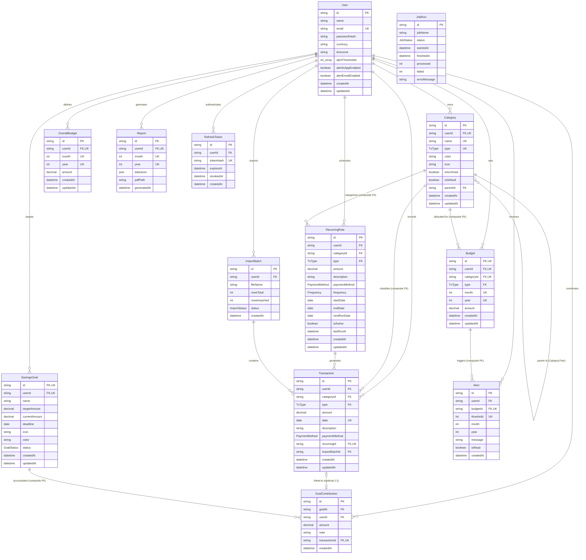

# FinTrack Database Entity Relationship & Constraints Reference

## 1. Mermaid Entity-Relationship Diagram (13 Tables)

---

## 2. Unique Constraints & Business Rules Table

| Table | Constraint / Index | Business Rule Enforced |
|---|---|---|
| `User` | `User_email_key` (`email`) | Prevents duplicate user accounts; each email is globally unique. |
| `Category` | `Category_userId_name_type_key` (`userId`, `name`, `type`) | Prevents duplicate category names for the same user and transaction type. |
| `Category` | `Category_id_userId_type_key` (`id`, `userId`, `type`) | Enables composite foreign keys to ensure cross-tenant and type isolation at the database level. |
| `Category` | `Category_userId_lowername_type_key` (`userId`, `lower(name)`, `type`) | Functional unique index enforcing case-insensitive category name uniqueness per user and type (e.g. "Food" vs "food"). |
| `Transaction` | `Transaction_recurringId_date_key` (`recurringId`, `date`) | Enforces idempotent recurring transaction generation (no duplicates per date), while permitting unlimited manual transactions (NULL recurringId). |
| `Budget` | `Budget_userId_categoryId_month_year_key` (`userId`, `categoryId`, `month`, `year`) | Ensures at most one category budget per category per calendar month for a user. |
| `Budget` | `Budget_id_userId_key` (`id`, `userId`) | Enables composite foreign key from Alert to Budget ensuring alerts can never reference another user's budget. |
| `OverallBudget` | `OverallBudget_userId_month_year_key` (`userId`, `month`, `year`) | Ensures at most one overall monthly spending budget per user for any given month/year. |
| `SavingsGoal` | `SavingsGoal_id_userId_key` (`id`, `userId`) | Enables composite foreign key from GoalContribution to SavingsGoal ensuring contributions cannot link to another user's goal. |
| `GoalContribution` | `GoalContribution_transactionId_key` (`transactionId`) | Enforces optional 1:1 relationship between an expense/income transaction and a goal contribution. |
| `Alert` | `Alert_budgetId_threshold_key` (`budgetId`, `threshold`) | Guarantees an alert for a specific threshold percentage (e.g. 80% or 100%) is generated at most once per monthly category budget. |
| `Report` | `Report_userId_month_year_key` (`userId`, `month`, `year`) | Ensures at most one generated monthly report record per user for a given month and year. |
| `RefreshToken` | `RefreshToken_tokenHash_key` (`tokenHash`) | Guarantees cryptographic refresh token uniqueness, preventing token replay attacks. |
